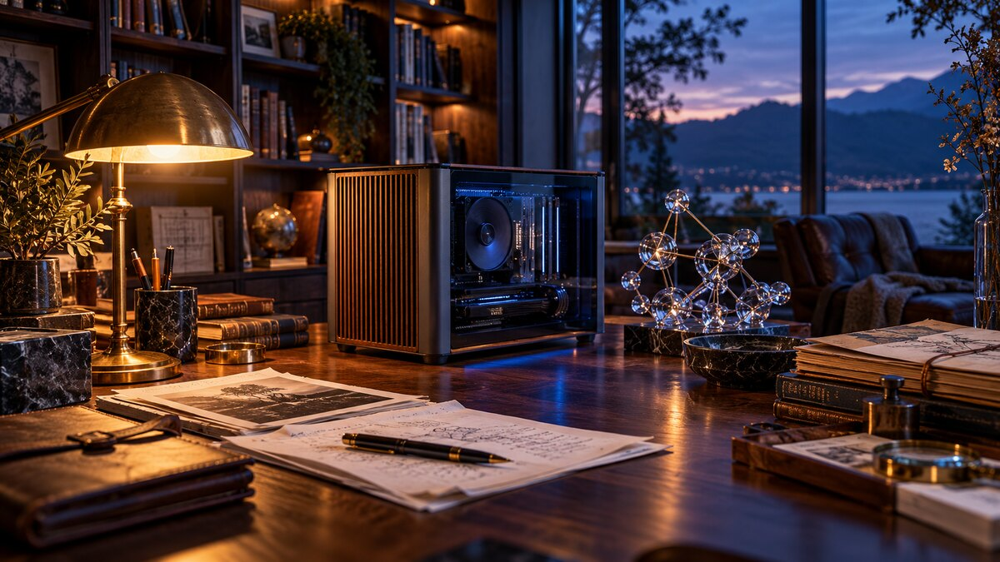
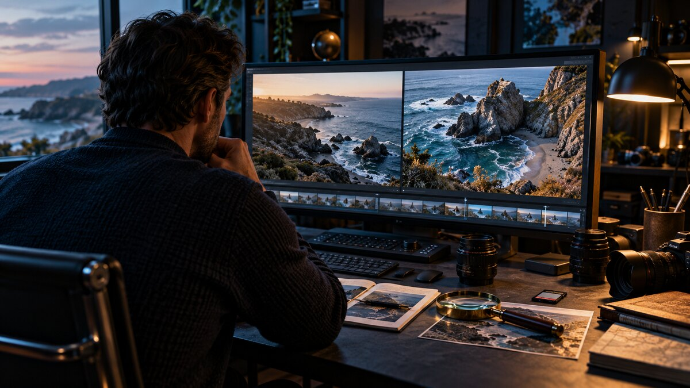

# Couvertures des cinq articles de la capture

Les schémas étaient utilisés comme couvertures : leur texte se retrouvait coupé dans les cartes. Cinq nouvelles scènes ont été créées pour ces cinq sujets, sans titre incrusté. Les titres restent des textes HTML lisibles et indexables.

## Les nouvelles illustrations

**IA locale — mémoire, ressources et évaluations**

**Lire une offre d’emploi — comprendre le travail et ses conditions**

**Vérifier une vidéo — comparer les images et documenter leur provenance**

**Playtest — observer une session et conserver les retours**

**Achat groupé — comparer les besoins et les équipements**

Ces scènes sont des illustrations créées avec une assistance IA. Elles ne représentent pas un reportage, un témoignage de membre ou un test réel.

## Intégration et référencement

Le rendu reconnaît les anciennes images du premier lot et utilise les nouveaux fichiers dans les cartes, le slider, les articles, les images sociales et le schéma Article. Les enregistrements existants ne sont pas réimportés : leurs URL, textes, auteurs, dates et relations restent en place.

Les anciennes images pédagogiques et les vidéos restent présentes. Une couverture personnalisée utilise son URL habituelle. Un texte alternatif personnalisé dans le champ natif est conservé ; seuls les anciens sous-titres des schémas reçoivent la nouvelle description par défaut.

Chaque image possède quatre variantes WebP — 480, 800, 1 200 et 1 600 px — et un JPEG de partage en 1 200 × 675 px. Les fichiers portent le thème de l’article et une version dans leur nom. `srcset`, `sizes`, dimensions, texte alternatif, crédit et métadonnées sociales sont fournis. Les titres restent en H1 dans les articles et H2 dans les cartes.

Les variantes mobiles pèsent de **24 392 à 36 622 octets**. Les cartes mobiles ont effectivement chargé les images de 480 px dans le test navigateur. Les pages avec vidéo peuvent réutiliser l’image de 1 200 px déjà chargée pour l’affiche du lecteur ; ces fichiers WebP pèsent entre 86 748 et 132 894 octets. Aucun PNG original lourd n’est servi par ce correctif.

Le robots.txt public consulté sur geniuspace.io le 22 octobre 2026 répond HTTP 200 et n’interdit pas le dossier `/media/com_joomcck/nexus/editorial/`. Cela ne constitue pas une promesse d’indexation ou de classement.

## Vérifications

- Les cinq articles déjà présents ont été ouverts sans réimportation ; leurs cartes affichent chacune la scène correspondant au sujet.
- Le slider conserve ses quatre éléments sélectionnés et son bouton suivant fonctionne avec les nouvelles images.
- Affichage ordinateur et mobile, décodage réel des images, proportions des cartes, absence de débordement horizontal mobile, descriptions alternatives, JPEG sociaux et schémas Article vérifiés : **74 contrôles navigateur passés**, aucune exception JavaScript.
- Registre des images : **103 contrôles**, dont la compatibilité des anciennes couvertures de la collection de douze univers et la conservation des textes alternatifs personnalisés.
- Une substitution de fichier par un administrateur a été simulée puis restaurée dans le laboratoire ; elle n’est pas remplacée par la résolution automatique.
- Installation réelle du paquet complet : **346 contrôles passés**. Aucun fichier antérieur supprimé ; les **899 fichiers de champs natifs** et **278 fichiers AVS** sont inchangés.
- Les champs des cinq publications restent identiques. La copie conserve **481 publications, 335 commentaires et 4 comptes**. Aucun nouvel article, compte ou commentaire n’a été créé pour cette correction.

Cette version corrige les **cinq couvertures de la capture**. Elle ne prétend pas créer 240 illustrations distinctes ; la collection et ses images d’univers restent conservées.

## Télécharger et installer

[Correctif installable complet 5.27.4](../../NEXUS_5.27.4.zip) · [Images seules avec galerie hors ligne](../../GENIUSPACE_5_ILLUSTRATIONS_5.27.4.zip)

Installez le paquet complet dans Joomla pour appliquer la correction aux articles déjà présents. Il n’est pas nécessaire de relancer l’import des cinq ou des 240 articles. Videz le cache Joomla après la mise à jour pour renouveler les pages HTML.

**La correction est testée sur la copie isolée ; elle n’est pas annoncée comme déployée sur geniuspace.io.**

Preuves : [navigateur](browser-results.json), [registre et compatibilité](native-results.json), [personnalisation](custom-cover-results.json), [installation](installation-results.json), [conservation des données](preservation-results.json), [manifeste du ZIP](MANIFEST.json), [manifeste des images](COVERS-MANIFEST.json).

Téléchargement intégral des deux ZIP vérifié sans authentification GitHub : **HTTP 200**, empreintes SHA-256 identiques et intégrité ZIP valide. [Preuve](download-verification.json).
