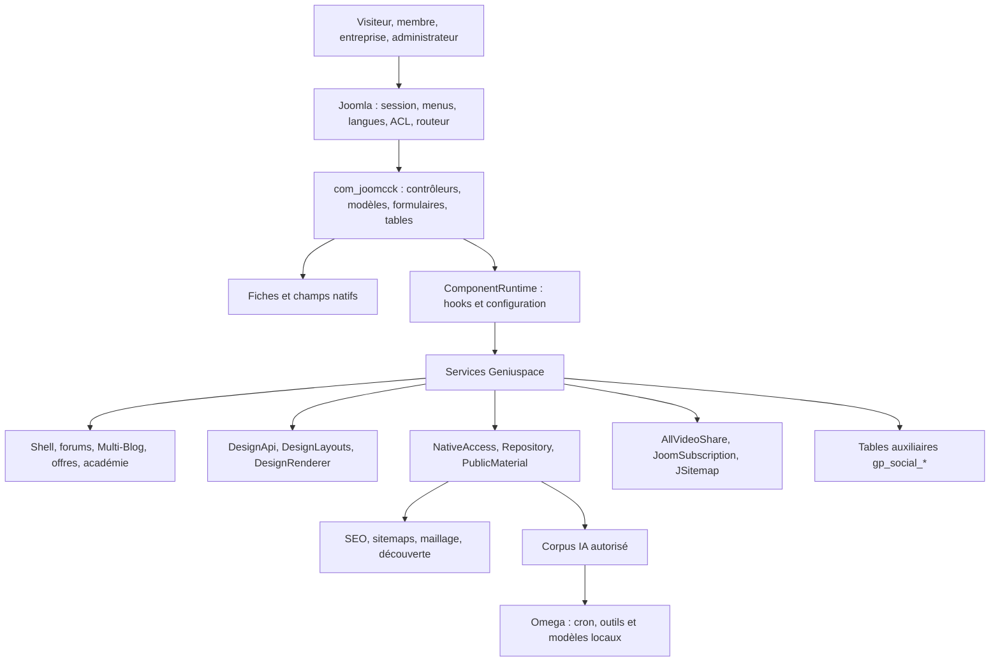
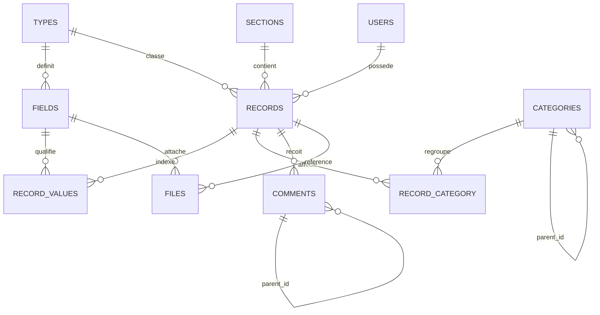
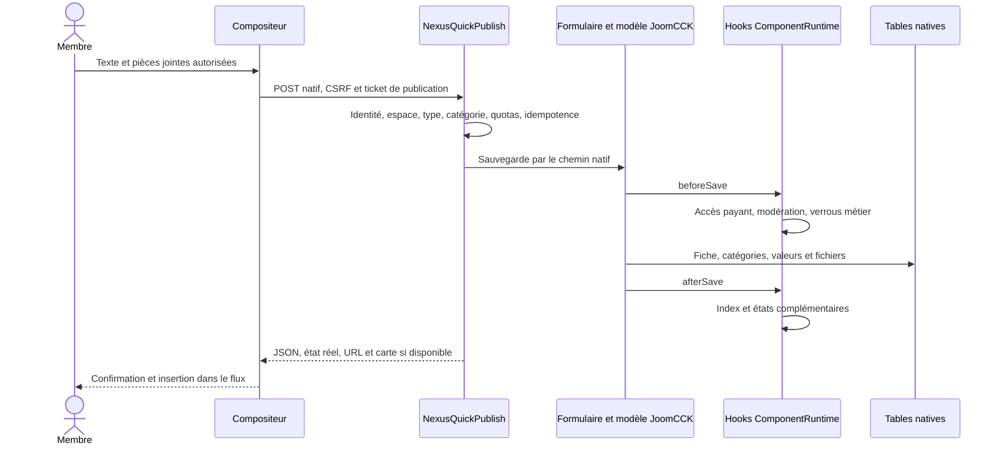
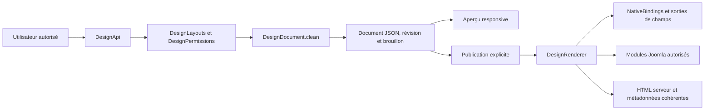
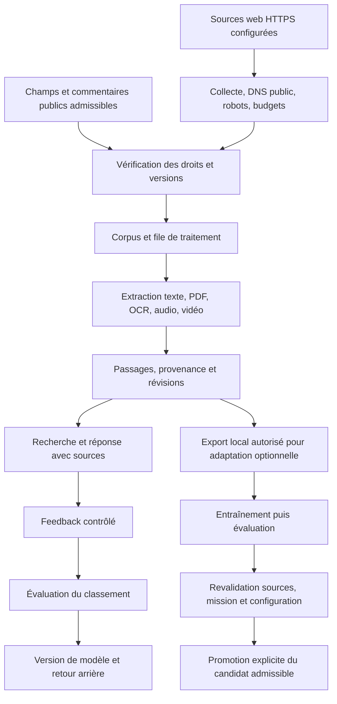
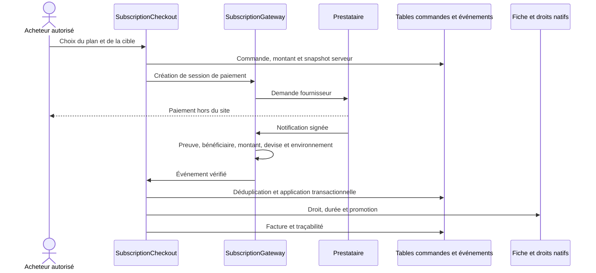

# Geniuspace — plan technique pour analyse externe

Version du code : **5.27.7**, composant JoomCCK **6.4.2.199**. Dossier établi le **24 octobre 2026**, référence de date Europe/Paris.

Ce document décrit le paquet source et la structure de la copie locale. Il ne décrit pas une nouvelle inspection du serveur de production. Les fichiers annexes donnent les fonctions, appels, expressions SQL et structures exactes que la synthèse ne développe pas entièrement.

## Sommaire

1. [Périmètre et preuves](#1-périmètre-et-preuves)
2. [Architecture globale](#2-architecture-globale)
3. [Arborescence et installation](#3-arborescence-et-installation)
4. [Carte des domaines et fonctions](#4-carte-des-domaines-et-fonctions)
5. [Données, champs et relations](#5-données-champs-et-relations)
6. [Routes, API et actions](#6-routes-api-et-actions)
7. [Parcours et séquences](#7-parcours-et-séquences)
8. [Design, widgets et formulaires](#8-design-widgets-et-formulaires)
9. [Recherche, SEO et maillage](#9-recherche-seo-et-maillage)
10. [IA et apprentissage](#10-ia-et-apprentissage)
11. [Abonnements et facturation](#11-abonnements-et-facturation)
12. [Sécurité et confidentialité](#12-sécurité-et-confidentialité)
13. [Requêtes SQL et performances](#13-requêtes-sql-et-performances)
14. [Exploitation et déploiement](#14-exploitation-et-déploiement)
15. [État vérifié et questions d’audit](#15-état-vérifié-et-questions-daudit)
16. [Mode d’emploi pour Gemini](#16-mode-demploi-pour-gemini)

## 1. Périmètre et preuves

| Mesure | Valeur |
|---|---:|
| Fichiers du paquet | 8,987 |
| Fichiers PHP tokenisés | 2,242 |
| Classes déclarées repérées | 1,478 |
| Fonctions et méthodes PHP nommées | 9,197 |
| Fichiers de services Geniuspace | 265 |
| Fonctions/méthodes de ces services | 1,743 |
| Expressions SQL source repérées, tout PHP | 2,375 |
| Expressions SQL des services Geniuspace | 1,167 |
| Sites d’appels statiques/objet repérés, tout PHP | 63,535 |
| Sites d’appels détaillés du noyau et entrées choisies | 13,174 |
| Tables locales, structure seule | 271 |
| Types / sections / champs / catégories locaux | 120 / 120 / 1849 / 401 |
| Formats de publication / univers | 23 / 12 |
| Définitions de widgets dans le registre local | 89 |

Les compteurs SQL et appels sont des occurrences statiques dans le code ; ils ne sont pas le nombre de requêtes d’une page.

Empreinte de l’arbre source : `3f06452a16e1bb724b174e41f86eef4a53aa5807bff836c8f40403bae377aafd`.

### Niveaux de confiance

| Niveau | Signification |
|---|---|
| Source | Déclaration, branche de code ou fichier effectivement présent dans le paquet. |
| Métadonnées locales | Structure des tables et définitions de champs/types/sections lues dans le laboratoire. Aucune ligne de membre, contenu, commentaire, facture ou modèle n’est exportée. |
| Vérification antérieure | Reçu de la version 5.27.7 produit pendant les essais précédents. Il est daté et ne constitue pas un nouvel essai en production. |
| À confirmer | Configuration, intégration fournisseur, comportement dynamique ou condition de production non vérifiés par ce dossier. |

**Une classe, un commentaire ou un libellé de maquette ne prouve pas qu’un service fonctionne en production.** Le catalogue contient des ambitions UX et des descriptions d’agents ; elles doivent être confrontées aux appels effectifs et à la configuration. Exemple : un texte évoquant des heures de jeu Steam/PSN ne prouve pas une intégration de télémétrie Steam/PSN active.

La cartographie PHP est obtenue par tokenisation, sans exécuter les fichiers inventoriés. Elle couvre les définitions nommées ; les callbacks anonymes, réceptions d’objets variables, appels réfléchis et héritages nécessitent une analyse complémentaire. Le catalogue SQL conserve les **expressions PHP sources**, sans les transformer en requêtes exécutables. Les listes de contrôleurs donnent des méthodes déclarées ; les alias de tâches Joomla et les contrôles d’accès déterminent l’exposition réelle.

Les repères `components/com_joomcck/site/...php:123` sont relatifs au **paquet source**, pas à la racine de Joomla installé. Voir la correspondance des chemins ci-dessous.

## 2. Architecture globale

Geniuspace est une application Joomla enrichie, fondée sur un **rendu serveur JoomCCK et des améliorations JavaScript progressives**. Ce n’est pas un frontend React séparé avec une base parallèle servant de source principale.

JoomCCK reste la source de vérité des fiches, types, champs, catégories, commentaires et relations natives. Les services Geniuspace ajoutent des projections, états métier, index, versions, files de travail et documents de design. Certaines anciennes tables génériques de services existent aussi : leur présence ne justifie pas de déplacer les fiches natives dans ces tables.



### Frontières importantes

- **Joomla** : identités, groupes, ACL, jetons CSRF, menus, cycle de requête, routeur et système d’extensions.
- **JoomCCK** : structure du contenu, champs, filtres, validation, soumission et rendu natif.
- **Services Geniuspace** : orchestration métier, expérience utilisateur, design, médias et IA.
- **Projection publique** : seule base admissible pour le SEO, les suggestions publiques, les sitemaps et les sources publiques de l’IA.
- **Prestataires externes** : paiements et sites collectés ; accès conditionnés à une configuration et à une politique réseau.
- **Workers locaux** : extraction/transcription/modèles/adaptation ; poids, exécutables et cron ne sont pas livrés automatiquement avec un petit plugin PHP.

## 3. Arborescence et installation

| Dans le paquet | Dans Joomla installé | Rôle |
|---|---|---|
| `components/com_joomcck/site/` | `components/com_joomcck/` | Code et vues côté site |
| `components/com_joomcck/admin/` | `administrator/components/com_joomcck/` | Administration |
| `components/com_joomcck/media/` | `media/com_joomcck/` | JS, CSS, images, bibliothèques et icônes |
| `components/com_joomcck/site/library/php/geniuspace/` | `components/com_joomcck/library/php/geniuspace/` | Services spécifiques |
| `plugins/plg_system_joomcck/` | `plugins/system/joomcck/` | Hooks système ; les endpoints de champs disposent aussi de leur dispatch composant |
| `plugins/user/geniuspaceidentity/` | `plugins/user/geniuspaceidentity/` | Identité et raccordements utilisateur |
| `modules/` | `modules/` | Modules natifs JoomCCK et AllVideoShare |
| `libraries/mint/` | `libraries/mint/` | Infrastructure de l’extension |
| `templates/nexus_canvas/`, `templates/geniuspace/` | `templates/.../` | Enveloppe et rendu du site |

Extensions comprises dans le paquet : JoomCCK 6.4.2.199, AllVideoShare 4.5.0, JoomSubscription 6.0.0.1 et JSitemap/JMap 4.30. **La version Joomla de l’hébergement et la compatibilité des scénarios fournisseurs doivent être confirmées sur la cible ; ces numéros sont ceux des manifestes distribués.**

Le cœur 5.27.7 est distribué séparément des deux packs des 240 illustrations, restés en version 5.27.6. L’ensemble contient le même arbre source. L’installation du code ne publie pas automatiquement les articles, les discussions ou les utilisateurs d’un autre serveur.

## 4. Carte des domaines et fonctions

| Domaine | Classes de services | Méthodes nommées | Annexe |
|---|---:|---:|---|
| Socle, accès et transactions | 32 | 174 | [Détail](domaines/01_socle_acces.md) |
| Shell, univers et ergonomie | 35 | 312 | [Détail](domaines/02_shell_navigation.md) |
| Publication et communauté | 29 | 171 | [Détail](domaines/03_publication_forum.md) |
| Design, widgets et formulaires | 31 | 176 | [Détail](domaines/04_design_widgets.md) |
| Médias et AllVideoShare | 13 | 66 | [Détail](domaines/05_medias.md) |
| Emploi et entreprises | 16 | 112 | [Détail](domaines/06_emploi_entreprise.md) |
| Académie et parcours | 16 | 104 | [Détail](domaines/07_academie_parcours.md) |
| SEO, SEF et recherche | 26 | 128 | [Détail](domaines/08_seo_recherche.md) |
| IA, ingestion et apprentissage | 16 | 103 | [Détail](domaines/09_ia.md) |
| Abonnements et facturation | 13 | 125 | [Détail](domaines/10_facturation.md) |
| Fonctions métiers et outils | 37 | 272 | [Détail](domaines/11_metiers.md) |

### Points d’entrée prioritaires

| Fonction | Responsabilité | Code |
|---|---|---|
| `Geniuspace\ComponentRuntime::configuration` | Configuration et raccordement des sections | `components/com_joomcck/site/library/php/geniuspace/ComponentRuntime.php:17` |
| `Geniuspace\ComponentRuntime::beforeSave` | Garde et hooks avant écriture native | `components/com_joomcck/site/library/php/geniuspace/ComponentRuntime.php:64` |
| `Geniuspace\NativeAccess::record` | Projection publique indépendante de l’administrateur connecté | `components/com_joomcck/site/library/php/geniuspace/NativeAccess.php:28` |
| `Geniuspace\Repository::base` | Filtre SQL commun de visibilité | `components/com_joomcck/site/library/php/geniuspace/Repository.php:111` |
| `Geniuspace\Repository::deniedCategories` | Contrôle des ancêtres de catégories | `components/com_joomcck/site/library/php/geniuspace/Repository.php:138` |
| `NexusQuickPublish::run` | Publication courte native et ticket idempotent | `components/com_joomcck/site/library/php/geniuspace/NexusQuickPublish.php:15` |
| `Geniuspace\DesignApi::dispatch` | Contrat HTTP du studio | `components/com_joomcck/site/library/php/geniuspace/DesignApi.php:8` |
| `Geniuspace\DesignLayouts::authorize` | Droits selon contexte de design | `components/com_joomcck/site/library/php/geniuspace/DesignLayouts.php:11` |
| `Geniuspace\DesignLayouts::write` | Révisions, brouillons et publication du layout | `components/com_joomcck/site/library/php/geniuspace/DesignLayouts.php:54` |
| `Geniuspace\NativeBindings::render` | Rendu réel d’un champ natif | `components/com_joomcck/site/library/php/geniuspace/NativeBindings.php:9` |
| `Geniuspace\NativeChunkStore::receive` | Réception et reprise des gros fichiers | `components/com_joomcck/site/library/php/geniuspace/NativeChunkStore.php:25` |
| `Geniuspace\ForumReviews::submit` | Avis, notes et contributions | `components/com_joomcck/site/library/php/geniuspace/ForumReviews.php:64` |
| `Geniuspace\ModerationBot::beforeSave` | Décision de modération avant sauvegarde | `components/com_joomcck/site/library/php/geniuspace/ModerationBot.php:131` |
| `Geniuspace\LegacyMembers::batch` | Import privé des membres | `components/com_joomcck/site/library/php/geniuspace/LegacyMembers.php:75` |
| `Geniuspace\NexusBlogIndex::data` | Index éditorial public et filtres | `components/com_joomcck/site/library/php/geniuspace/NexusBlogIndex.php:31` |
| `Geniuspace\NexusSitemap::response` | Plan du site et images publiques | `components/com_joomcck/site/library/php/geniuspace/NexusSitemap.php:8` |
| `Geniuspace\OmegaMemory::current` | Droit et révision de la source IA | `components/com_joomcck/site/library/php/geniuspace/OmegaMemory.php:56` |
| `Geniuspace\OmegaMemory::tick` | Cycle de mémoire multimodale | `components/com_joomcck/site/library/php/geniuspace/OmegaMemory.php:179` |
| `Geniuspace\OmegaRanker::train` | Apprentissage évalué du classement | `components/com_joomcck/site/library/php/geniuspace/OmegaRanker.php:55` |
| `Geniuspace\OmegaAdaptation::tick` | Adaptation optionnelle d’un modèle local | `components/com_joomcck/site/library/php/geniuspace/OmegaAdaptation.php:25` |
| `Geniuspace\SubscriptionGateway::notification` | Authenticité et contenu des événements fournisseurs | `components/com_joomcck/site/library/php/geniuspace/SubscriptionGateway.php:88` |
| `Geniuspace\SubscriptionCheckout::apply` | Application d’un événement de facturation | `components/com_joomcck/site/library/php/geniuspace/SubscriptionCheckout.php:57` |
| `Geniuspace\TransactionHealth::report` | État des moteurs transactionnels | `components/com_joomcck/site/library/php/geniuspace/TransactionHealth.php:9` |

Les cartes complètes sont dans `cartes/02_classes.csv`, `03_fonctions_tout_php.csv`, `04_fonctions_geniuspace.csv`, `05_appels_geniuspace.csv` et `06_dependances_classes.csv`. Chaque entrée fournit le fichier et les lignes. `cartes/07_javascript_indices.csv` recense des fonctions, événements, sélecteurs et appels `fetch` repérés lexicalement ; il ne représente pas un AST JavaScript complet.

## 5. Données, champs et relations

### Source de vérité native

| Table logique | Responsabilité | Attention |
|---|---|---|
| `#__js_res_record` | Fiche : titre, alias, type, section, propriétaire, publication, accès, dates, champs sérialisés et métadonnées | Le JSON des champs n’est pas une projection publique. |
| `#__js_res_fields` | Définition du champ, type, alias, paramètres, accès, filtre, sémantique | Les identifiants et paramètres sont configurables. |
| `#__js_res_record_values` | Index natif des valeurs et relations | Doit rester cohérent avec les valeurs de la fiche. Ne pas mettre à jour un seul côté. |
| `#__js_res_types` | Types et choix de templates, soumission, commentaires, sémantique | Un type n’est pas une catégorie. |
| `#__js_res_sections` | Sections, types autorisés, rendu et options | Les droits de section s’ajoutent à ceux du contenu. |
| `#__js_res_categories` | Hiérarchie native et métadonnées de catégories | Les parents, accès et états doivent être vérifiés, pas seulement la catégorie terminale. |
| `#__js_res_record_category` | Affectation de la fiche aux catégories | Relation plusieurs-à-plusieurs, cohérence de section requise. |
| `#__js_res_comments` | Commentaires, auteurs, hiérarchie, publication et confidentialité | Compter et exporter seulement les contributions autorisées. |
| `#__js_res_files` | Références des médias natifs | Le fichier physique et sa référence de champ doivent correspondre. |
| `#__users`, `#__user_usergroup_map`, `#__user_profiles` | Comptes Joomla, groupes et métadonnées de migration | Ne jamais transformer un enregistrement de migration en preuve d’identité vérifiée. |



Ce schéma représente des **relations logiques**. Il ne prétend pas que toutes sont des clés étrangères SQL physiquement imposées. Voir le DDL exact dans `base/03_schema_structure_seule.sql`.

### Champs et relations

- Le paquet contient les définitions de 87 types de champs ; la copie locale possède 1 849 instances de champs. Ces nombres ne sont pas interchangeables.
- Le contrat principal demandé est celui des champs natifs **`parent` et `child`**. Leur interprétation passe notamment par `ExtendedFields::targets`, les paramètres `parent_type`, `parent_section`, `child_field`, `child_section` et les index de valeurs.
- Des champs historiques `gprelation` et des tables de relations génériques existent aussi. Ils ne doivent pas remplacer silencieusement le contrat parent/enfant des fiches.
- Les 48 instances locales de champs parent/enfant et leurs cibles sont cartographiées dans `base/05_relations_natives.json`.
- L’ajout d’un champ à un type ne doit pas casser le rendu. Le binding doit être configuré et les champs non positionnés doivent conserver un accès natif dans le formulaire.
- Les filtres reposent sur les définitions et index des champs. Un champ ne devient pas un filtre SQL fiable uniquement parce qu’un contrôle visuel est ajouté à la page.
- Les répétitions structurées utilisent notamment `gpsubform` et leurs validations. Ne pas supposer que tous les champs médias/relations complexes peuvent être dupliqués comme du texte.

### Tables auxiliaires

Les familles `#__gp_social_*` couvrent notamment présence et réactions, avis et détails, projets/missions, parcours, recrutements, versions, index de connaissances, mémoire Omega, design, paiements et factures. Les tables des fournisseurs conservent leurs contrats propres (`#__allvideoshare_*`, `#__joomsubscription_*`, `#__jmap_*`).

Les métadonnées locales comprennent des types, sections et contenus de démonstration. **120 types/sections ne signifient pas 120 univers métiers en production.** Les identifiants du laboratoire ne doivent pas devenir des constantes de configuration déployables.

Liste des tables non InnoDB observées : `#__finder_tokens` (MEMORY), `#__finder_tokens_aggregate` (MEMORY), `#__js_ip_2_country` (MyISAM). La liste des 271 tables et leurs colonnes/index figure dans les annexes. Aucune ligne applicative n’est incluse.

## 6. Routes, API et actions

### Pages publiques

| Route conceptuelle | Interprétation |
|---|---|
| `/hub` | Entrée du Méta-Hub, selon les menus Joomla réellement configurés |
| `/hub/<univers>/<catégorie…>` | Silo de catégories, plusieurs niveaux possibles |
| `/thread/<alias>` | Fiche native, interprétée selon son format et son type |
| `?nx_mode=blog` | Index Multi-Blog ou vue éditoriale de la fiche dans le shell |
| `?nx_mode=forum` | Exploration/forum dans le même shell |
| Pages d’offres et de leurs fiches | `EmploymentRoutes` et menus natifs ; utiliser l’URL produite par le routeur, pas un ID fixé dans un lien |
| Formulaire d’ajout/modification | Vue/formulaire JoomCCK avec validations et ACL natives |

Le mot « blog » dans l’URL du mode ne signifie pas qu’il faut ouvrir arbitrairement le premier article. Un index doit rester un index. Chaque fiche conserve son URL canonique, même si une prévisualisation est affichée en master/detail ou split-screen.

### Contrôleur Geniuspace

Le point de dispatch commun est `index.php?option=com_joomcck&task=geniuspace.<méthode>`. Certains services historiques sont aussi accessibles via `geniuspace.dispatch` et `gp_path`, par exemple `/evaluation/...`, `/communaute/...` et les routes du studio. Il faut lire le routeur concerné avant de déduire un endpoint REST.

| Tâche | Garde observée dans la méthode (non exhaustive) | Source |
|---|---|---|
| `geniuspace.subscriptions` | Délégation : lire le service appelé | L8 |
| `geniuspace.subscriptionWebhook` | Délégation : lire le service appelé | L9 |
| `geniuspace.jobPreview` | getMethod, NativeAccess | L17 |
| `geniuspace.product` | Tokens::valid, HTTP_X_GENIUSPACE_CSRF, REQUEST_METHOD | L32 |
| `geniuspace.designStudio` | Délégation : lire le service appelé | L58 |
| `geniuspace.designApi` | Délégation : lire le service appelé | L59 |
| `geniuspace.productRead` | REQUEST_METHOD | L60 |
| `geniuspace.nativeMedia` | REQUEST_METHOD | L69 |
| `geniuspace.participationUpload` | nativePost | L77 |
| `geniuspace.productMedia` | REQUEST_METHOD | L85 |
| `geniuspace.repairNexus` | nativePost, authorise | L92 |
| `geniuspace.demo` | nativePost | L106 |
| `geniuspace.forumSetup` | nativePost | L114 |
| `geniuspace.editorialPack` | nativePost | L125 |
| `geniuspace.editorialCollection2026` | nativePost | L133 |
| `geniuspace.forumRadar` | getMethod | L141 |
| `geniuspace.editorialTopics2026` | nativePost | L153 |
| `geniuspace.memberImport` | nativePost, authorise | L161 |
| `geniuspace.editorialLibrary2026` | nativePost | L174 |
| `geniuspace.shellBindings` | nativePost | L182 |
| `geniuspace.vault` | nativePost | L190 |
| `geniuspace.vaultDownload` | REQUEST_METHOD | L202 |
| `geniuspace.creatorRevenue` | nativePost | L209 |
| `geniuspace.workstyle` | Tokens::valid, REQUEST_METHOD | L216 |
| `geniuspace.cohort` | Tokens::valid, REQUEST_METHOD | L226 |
| `geniuspace.hiring` | Tokens::valid, REQUEST_METHOD | L236 |
| `geniuspace.talentmarket` | Tokens::valid, REQUEST_METHOD | L246 |
| `geniuspace.community` | Tokens::valid, REQUEST_METHOD | L257 |
| `geniuspace.omega` | HTTP_X_GENIUSPACE_CSRF, REQUEST_METHOD | L268 |
| `geniuspace.sitemap` | REQUEST_METHOD | L284 |
| `geniuspace.discovery` | Délégation : lire le service appelé | L292 |
| `geniuspace.openapi` | Délégation : lire le service appelé | L293 |
| `geniuspace.semantic` | REQUEST_METHOD | L305 |
| `geniuspace.extendedPay` | REQUEST_METHOD | L316 |
| `geniuspace.assist` | HTTP_X_GENIUSPACE_CSRF, REQUEST_METHOD | L327 |
| `geniuspace.dispatch` | Tokens::valid, HTTP_X_GENIUSPACE_CSRF, REQUEST_METHOD | L341 |

### Contrats à conserver

- `geniuspace.product` : mutations métier, authentification, POST, CSRF, origine, normalisation, puis `ProductActions::handle`. Les actions incluent les comptes, équipes, états/réactions/présence, reviews, opportunités, corrections et exercices. Certains espaces d’actions sont délégués (`moderation.*`, `project.*`, `path.*`, `experience.*`, `multiverse.*`).
- `geniuspace.productRead` : lecture de suggestions et contextes ; ne doit jamais prendre l’utilisateur connecté comme preuve qu’une donnée est publique.
- `geniuspace.designApi` : documents et opérations du studio. Authentification native, droits par contexte, JSON borné, CSRF via `X-Geniuspace-CSRF`, et contrôle d’origine sur les mutations.
- `geniuspace.omega` : cockpit IA et sous-actions, avec différences de droits entre recherche/feedback et administration des missions.
- `geniuspace.subscriptionWebhook` : authentification par preuve fournisseur ; ne pas exiger une session utilisateur à la place de la signature du prestataire.
- `geniuspace.nativeMedia` : contrôle d’accès au média avant streaming, plages d’octets et variantes. Ce point ne doit pas devenir un simple serveur public de chemins arbitraires.
- `geniuspace.sitemap` et découverte : projection publique fraîche, exclusion des brouillons et données privées.
- `geniuspace.memberImport` : administrateur, POST, CSRF, CSV strict et stockage de lot privé.

L’en-tête CSRF n’est pas un secret permanent d’intégration. Le token varie avec la session ; ne pas le copier dans une documentation ou une configuration statique.

## 7. Parcours et séquences

### Message court



Un texte court ne doit pas être effacé pour ouvrir un grand formulaire. En revanche, le serveur peut exiger des informations obligatoires ou retenir un contenu selon la configuration. La carte immédiate n’autorise pas le navigateur à décider lui-même de `published`, `access`, `hits` ou de son propriétaire.

### Publication spécialisée

Choix du format → sélection d’une destination autorisée → formulaire polymorphe/étapes → champs natifs → aperçu → validation native → publication/modération réelle. Une vidéo, une offre, un reportage, un avis produit ou une coalition ont des ensembles de champs différents. La destination ne doit pas être choisie par une chaîne de texte ressemblant au nom d’un univers.

### Entreprise et candidat

Fiche entreprise et droits d’équipe → création d’offre → fiche d’offre canonique et aperçu → questions attachées aux conditions → preuves/compétences/cours/exercices si nécessaires → candidature native → pipeline de recrutement → tableau de travail autorisé. L’interface ne doit pas transformer une recommandation pédagogique facultative en condition de candidature inventée.

`AccountIdentity` relie les comptes aux fiches autorisées, logos et raccourcis ; `CompanyTeam` porte les rôles. Le simple domaine d’un email n’est pas une autorisation d’administration d’une entreprise.

### Avis et notes

Format d’avis sélectionné → champ de review approprié → note/avis de rédaction distincts → contributions des utilisateurs avec texte, points positifs/négatifs et note → agrégation réelle dans `forum_reviews`/`forum_review_details` → rendu et schéma correspondant. Ne pas fusionner une note de rédaction avec une moyenne de membres et ne pas fabriquer de `AggregateRating` sans notes admissibles.

### Vidéo volumineuse

Champ média natif ou `gpavsvideo` → contrôle de dépôt → chunks et état de reprise → assemblage/validation du fichier complet → référence native → pont éventuel vers AllVideoShare → lecture responsive → chapitres/timestamps → discussion et avis de la fiche.

Le chunking permet de dépasser la limite d’un **envoi HTTP individuel**, pas les limites de disque, quota, durée d’exécution, type de fichier et budget configuré. La disponibilité du transcodage dépend des outils réellement installés.

### Lecture publique

URL native → route et menu → gates natifs → champs effectivement publics → template spécialisé dans le shell → image/texte/auteur → schémas et canonique → liens natifs vers d’autres contenus admissibles. Une prévisualisation privée ne doit pas publier ses métadonnées ou son texte dans les index d’agents.

## 8. Design, widgets et formulaires

### Modèle de document

Le studio utilise des documents JSON versionnés, des régions et blocs typés, des paramètres de style et des bindings vers les champs natifs. Les scopes annoncés par le contrat sont `universe`, `company`, `record` et `form`.



Le catalogue comprend notamment sections imbriquées, titres, textes, boutons avec icônes, images, galeries, sliders à scènes, carrousels, newstickers, lecteurs, modules Joomla, champs, étapes de formulaire, commentaires, zones de réponse, publicités identifiées, menus/méga-menus, listes, accordéons, tabs, recherches et reviews. La liste exacte avec propriétés typées est dans `catalogues/06_widgets_metadonnees.json`.

Contrat exact : `api/04_contrat_design_api.json` et `DesignExtension::contract`.

- Les documents doivent être validés avant aperçu/sauvegarde/publication.
- La révision attendue protège contre l’écrasement d’une modification concurrente.
- Les droits ne se limitent pas à l’affichage d’un bouton « Personnaliser » : ils doivent être revérifiés sur les opérations serveur.
- Les bibliothèques JSON étendent des bases natives autorisées. Un JSON importé n’est pas du PHP/JavaScript à exécuter.
- Un plugin Joomla de confiance peut enregistrer un fournisseur PHP via `DesignLibrary::register`. Cela relève d’une installation de code privilégiée, distincte d’un import de données.
- Les zones natives restent rendues par le système existant. Les masquer ou les repositionner dans un layout n’équivaut pas à supprimer leurs données.
- Le rendu d’un champ réutilise sa sortie native avec son template et ses ACL, notamment via `NativeBindings::render`.
- Les contrôles d’édition, poignées, croix et actions de suppression doivent apparaître uniquement dans leur mode prévu. Les préférences personnelles de fermeture d’un widget sont distinctes de la suppression d’un bloc pour tous.
- L’ajout d’images « partout » doit rester contraint par le layout responsive et l’accessibilité ; il ne faut pas déduire un positionnement absolu illimité et indépendant de la grille.

Ne pas supposer une compatibilité binaire complète avec tous les addons Revolution Slider/YOOtheme. Le projet reprend des familles de capacités dans son propre contrat natif ; une promesse de parité doit être vérifiée widget par widget.

## 9. Recherche, SEO et maillage

### Chaîne publique

`NativeAccess`/`Repository` → `PublicMaterial` → rendu, index, `NexusSitemap`, `PublicDiscovery`, recherche et citations autorisées.

- `ForumRoutes`, `EmploymentRoutes` et `NativeUrls` produisent les URL canoniques selon les menus et identités natives.
- Les alias ne sont pas supposés uniques sur tout le site. Les scopes de section et les historiques d’URL comptent.
- Les catégories possèdent des métadonnées et une hiérarchie. Les anciennes racines et les nouvelles racines d’un univers peuvent coexister : ne pas choisir arbitrairement la dernière catégorie au même nom.
- `NexusBlogIndex` est un index d’articles/vidéos/podcasts/reportages/reviews, avec filtres, auteur, slider et commentaires récents.
- La portée d’une catégorie doit être identique entre l’URL canonique et son rechargement. Les facettes et recherches utiles peuvent rester `noindex, follow` sans supprimer la navigation.
- `NexusKnowledge` indexe des passages ; la recherche réévalue l’accès et la révision des sources. Elle n’est pas un simple `LIKE` sur toutes les descriptions privées.
- Les champs `parent`/`child`, `LinkIndex`, `SemanticLinks` et leurs projections alimentent le maillage natif. Les liens sponsorisés ont une qualification distincte.
- Le titre, H1/H2/H3, l’extrait, l’auteur, les dates et les images proviennent des champs rendus ; le schema doit décrire ce qui est effectivement présent et autorisé.
- Les schémas utilisés incluent Article/BlogPosting, DiscussionForumPosting, ImageObject, VideoObject, JobPosting, Course, Organization, Product et avis quand leurs données sont suffisantes. Ne pas émettre un type incomplet pour obtenir artificiellement un résultat enrichi.
- `JmapBridge` raccorde les identités et données publiques à JSitemap ; le composant JMap du fournisseur reste un sous-système distinct.

### Images

`EditorialImages` gère les variantes connues, les empreintes, les crédits et la résolution des anciens fichiers dans le contexte de leur fiche. Une ancienne URL `geniuspace.nativeMedia&file=...` n’est pas équivalente à une URL statique quelconque : son propriétaire, son champ et ses octets sont contrôlés avant substitution d’une couverture de série.

Les 240 illustrations éditoriales ont quatre tailles WebP et un JPEG social. Les textes alternatifs ne doivent pas effacer ceux personnalisés par l’administrateur. Les dimensions ne sont affirmées que pour un asset connu. Les fichiers doivent être accessibles en HTTP : un bon `ImageObject` ne répare pas une image 404.

### SEO pour moteurs et agents

Les agents doivent recevoir des sources lisibles, stables, datées, attribuées et reliées à leurs preuves. JSON-LD, sitemaps et descriptions aident cette découverte ; ils ne garantissent ni l’indexation, ni un classement, ni une citation par un LLM. SEM nécessite en outre campagnes, objectifs et mesure de conversion ; un balisage ne crée pas une campagne publicitaire.

Le dernier contrôle public joint aux preuves est celui du **23 octobre 2026** : une couverture historique était accessible, une couverture de la collection retournait 404 et la requête du sitemap expirait. Ce dossier du 24 octobre ne prétend pas constater une correction de ces points sur le serveur public.

## 10. IA et apprentissage

### Quatre mécanismes à distinguer

| Mécanisme | Services principaux | Ce que cela signifie |
|---|---|---|
| Recherche de passages/RAG | NexusKnowledge, OmegaMemory, OmegaGeneration | Retrouver des sources autorisées et les utiliser comme contexte. |
| Apprentissage du classement | OmegaRanker | Ajuster le classement à partir de feedback et d’évaluations ; ce n’est pas l’entraînement des poids d’un LLM général. |
| Petit modèle local de pertinence | NeuralTrainer, NeuralStore, LocalLearning, Omega | Apprentissage borné et évaluation séparée ; les limites du modèle doivent rester explicites. |
| Adaptation optionnelle des poids d’un modèle de langage | OmegaAdaptation, `ai/local-model.py` | Entraînement local conditionné aux poids, outils, données, ressources et réglages réellement présents. |



### Collecte et mémoire

- `OmegaWeb` contrôle les URL HTTPS, adresses publiques, DNS épinglé, redirections, robots.txt, taille, durée et origine des liens explorés. Les textes collectés sont des **données**, pas des commandes de l’agent.
- `OmegaMemory` découvre par curseurs les fiches, commentaires et ressources admissibles, suit des révisions et retraits, utilise des leases et reprend les lots. Un lot borné ne signifie pas nécessairement que le corpus complet est limité à ce lot.
- `OmegaExtract` et `OmegaRuntime` orchestrent les outils locaux. PDF, OCR, ffmpeg, transcription et génération ne sont disponibles que si les exécutables/poids requis sont configurés.
- Les sorties et délais des sous-processus sont bornés. Le code doit éviter la construction d’une commande shell à partir du contenu utilisateur.
- Les passages devenus privés ou retirés doivent cesser d’être lisibles avant même le nettoyage physique différé.
- Les feedbacks des membres sont des signaux à protéger contre le bruit, les conflits d’intérêts et l’empoisonnement. Le code présent ne justifie pas une promesse d’auto-amélioration sans erreur.

### Exploitation IA

L’entrée CLI prévue est, dans le Joomla installé :

```text
php /chemin/joomla/components/com_joomcck/omega.php https://geniuspace.io
```

Le premier argument est une **URL HTTPS du site**, pas le chemin du Joomla. Le script configure le contexte Joomla puis appelle les cycles et l’adaptation optionnelle. Sa fréquence de cron doit être choisie selon les budgets et les verrous ; ce dossier ne crée ni ne modifie un cron.

La configuration d’outils et modèles est externe à la racine publique, sélectionnable par `NEXUS_OMEGA_CONFIG`. Ne pas inclure sa valeur, le contenu de ce fichier, les poids ou des secrets dans une analyse publique. Les noms d’options sont documentables ; leurs valeurs privées ne le sont pas.

`OmegaCockpit::status` expose aussi des limites et annonce qu’un modèle de langage n’est pas livré dans le paquet. Certaines limites sont configurables, d’autres sont fixées par un composant. Il faut distinguer capacité de stockage, taille de lot, fenêtre de travail, vocabulaire d’un petit modèle et contexte d’un LLM.

**À vérifier séparément** : corpus de référence et jeu d’évaluation, qualité des réponses/citations, résultats avant/après, régressions, résistance à l’empoisonnement, permissions par ressource et politique de promotion. Aucune performance de modèle en production n’est prouvée par une simple classe `AiProgress`.

## 11. Abonnements et facturation

`SubscriptionPlans`, `SubscriptionCheckout`, `SubscriptionGateway`, `SubscriptionEntitlements`, `SubscriptionRuntime` et `SubscriptionSchema` raccordent les offres commerciales à JoomSubscription et aux fiches natives.

Usages prévus : publication payante, mise en avant limitée dans le temps, campagnes publicitaires sur positions, couleurs/styles de promotion et facture. Plans, prix, durées, comptes fournisseurs et états réels doivent être configurés ; un encart commercial visible n’est pas la preuve d’un paiement.

Prestataires présents dans le code : **Stripe, PayPal et un chemin crypto via NOWPayments**, avec actifs/réseaux autorisés par configuration. La demande d’accepter BTC/USDT/USDC/PAXG n’implique pas que chaque actif soit effectivement disponible sur chaque réseau ou compte fournisseur.



Le retour navigateur « succès » ne doit pas accorder un droit payé. Les remboursements, disputes, expirations et notifications dupliquées doivent conserver des états cohérents. Les champs d’accès payant ont aussi un impact sur le SEO public et sur les sources de l’IA.

La présence des connecteurs ne prouve pas une transaction réelle validée auprès des fournisseurs. Les clés, secrets de webhook, bénéficiaires et tests réels ne sont pas exportés.

## 12. Sécurité et confidentialité

### Invariants à analyser

1. Session Joomla, compte actif et autorisation de l’action, pas seulement authentification.
2. POST/CSRF/origine sur les mutations modernes ; preuve fournisseur propre pour les webhooks.
3. Données de type/section/catégorie/field/record cohérentes ; aucune confiance dans l’ID envoyé par le navigateur.
4. Garde publique indépendante du super-administrateur connecté pour les schémas, index, citations et exports.
5. Catégories parentes privées/dépubliées, dates de publication/expiration, abonnements et champs réservés respectés.
6. Fichiers : type, MIME, taille par chunk et assemblée, chemins, propriétaire, référence au champ, quotas et suppression ; pas d’exécutable à partir des uploads.
7. Pas d’HTML, SVG, JSON de widget ou contenu de source converti librement en code exécutable.
8. Pas de cache partagé contenant données de candidat, membre, paiement, passeport, formulaire ou brouillon privé.
9. Concurrence : révision attendue, verrous, idempotence, transaction ou compensation explicitée.
10. Logs et messages sans secrets ni détails privés inutiles ; bonnes réponses 403/404/409/413/422/429/503 selon les cas.

### Import historique des membres

`LegacyMembers` lit un CSV strict, ignore le mot de passe fourni, utilise des secrets distincts et un renouvellement obligatoire, remappe les identifiants, limite le groupe attribué et conserve les comptes existants. Il crée des fiches privées avec les valeurs historiques et refuse d’attribuer automatiquement des preuves/badges à partir de déclarations importées.

Les fichiers temporaires de lot sont privés, hors de la racine web, et n’intègrent pas le mot de passe en clair. Le SQL fourni par l’utilisateur n’est pas exécuté. Les 450 comptes de la copie ont été importés désactivés ; leur existence n’est pas une preuve de 450 utilisateurs actifs, de leur consentement à une republication ou de leur identité certifiée.

Le dossier présent n’exporte **aucun** de leurs emails, noms de compte, profils, avatars, données de localisation ou mots de passe. Les champs de schéma portant les noms `email`, `password`, `token` décrivent une structure, pas leurs valeurs.

### Transactions et moteurs

La structure observée localement comprend 268 tables InnoDB, deux tables MEMORY du moteur Finder et une table MyISAM `#__js_ip_2_country`. Cela **ne décrit pas automatiquement les moteurs de production**. La table géographique en lecture et une table participant à un paiement n’ont pas le même besoin transactionnel.

Le code garde des précontrôles (`TransactionHealth`, `SubscriptionSchema::transactional`, verrous et compensations). Une compensation MyISAM ne vaut pas une transaction ACID ni une garantie contre toute coupure. Une conversion InnoDB doit être précédée de sauvegardes, mesures de taille/temps, vérification des index et répétition du scénario de restauration.

## 13. Requêtes SQL et performances

### Contenu du catalogue

- `sql/01_requetes_source_tout_php.csv` : expressions SQL repérées dans l’ensemble PHP.
- `sql/02_requetes_geniuspace.csv` : sous-ensemble du noyau de services.
- `sql/03_operations_orm.csv` : appels ORM/mutations/transactions candidats.
- `sql/04_appels_query_builder_candidats.csv` : constructions de requêtes à analyser séparément.
- `sql/05_tables_vers_requetes.json` : index inverse table → requêtes et fonctions sources.
- `base/03_schema_structure_seule.sql` : colonnes, index et contraintes réellement présents dans la copie, sans données.

Une requête construite dynamiquement, un filtre natif ou un query builder ne se reconstitue pas toujours à partir d’une seule chaîne. Les variables n’ont pas été substituées, et aucune valeur d’utilisateur n’a été injectée dans les exemples. **Ne pas exécuter ces expressions telles quelles.**

### Familles critiques

| Famille | Chemin source | Tables/risques à examiner |
|---|---|---|
| Projection publique | NativeAccess / Repository / ExtendedGate | Publication, accès, dates, ancêtres, abonnements et champs privés |
| Index et facettes | NexusBlogIndex / EmploymentFilters / QueryBuilder | Index de valeurs, sélectivité, types de comparaison, pagination et `COUNT` |
| Relations et maillage | ExtendedFields / LinkIndex / SemanticLinks | Direction parent/enfant, cohérence du type cible, jointures et N+1 |
| Discussions/avis | NexusConversation / ForumReviews | Filtrage privé/public, arbres, agrégations et requêtes répétées |
| Design | DesignLayouts / DesignData / DesignRenderer | Documents et révisions, sources de blocs, répétitions par widget |
| IA | NexusKnowledge / OmegaMemory / OmegaRanker | Recherche, index plein texte, révisions, leases et invalidations |
| Paiement | SubscriptionCheckout / SubscriptionEntitlements | Unicité des événements, verrous, montants et cohérence des droits |
| Import | LegacyMembers | Conflits de comptes, reprise, index de champs et confidentialité |

### Mesures antérieures de la copie 5.27.7

| Parcours | Requêtes après optimisations | SQL mesuré | Mémoire de pointe | Médiane HTTP locale |
|---|---:|---:|---:|---:|
| Multi-Blog | 1 335 | 0,882 s | 64 Mio | 3,091 s |
| Forum, URL de test avec redirection | 1 728 | 0,705 s | 68 Mio | 4,076 s |

Dans le même volume de nouveaux contenus, les dernières optimisations ont réduit les requêtes de 4 276 à 1 335 et de 4 522 à 1 728. Ce sont des mesures de laboratoire, pas des Core Web Vitals de production. Les pages restent coûteuses ; il ne faut pas qualifier ce résultat de chargement instantané.

Optimisations présentes : lectures réutilisées pendant une requête GET/HEAD, définitions publiques partagées dans cette requête, identités de routes, suppression de lectures redondantes, et radar détaillé chargé à l’ouverture. Les instantanés ne sont pas un cache global distribué. La bascule entre modes utilise les DOM déjà rendus : les vérifications antérieures ont observé zéro navigation et environ 182 ms de médiane de bascule.

Pour aller plus loin : instrumenter un parcours comparable, isoler le TTFB du rendu et des images, mesurer le nombre de requêtes et leurs sources, utiliser `EXPLAIN` sur une copie avec des paramètres représentatifs, examiner les index composites, réduire les N+1 par lots sans élargir l’accès, puis mesurer LCP/INP/CLS réellement. Ne pas accélérer un export en supprimant ses contrôles ACL.

## 14. Exploitation et déploiement

### Dépendances et budgets

- Joomla et ses extensions installés sur une version PHP compatible ; le laboratoire utilisé pour les reçus dispose de PHP 8.4.24.
- La métadonnée locale lue pour ce dossier indique **Joomla 6.1.4**. Il faut confirmer la version de production séparément.
- MySQL/MariaDB avec moteurs, collations, index et capacités réellement vérifiés sur l’hébergement.
- Stockage public de médias éditoriaux distinct des uploads et fichiers de travail privés.
- PHP/serveur : tailles de requête, disque, quotas, délais et nombre de workers à aligner sur les usages vidéo.
- IA : outils OCR/PDF/audio/vidéo, poids locaux, bibliothèques Python et dispositif CPU/GPU selon configuration.
- Cron, leases, reprises et logs à surveiller ; l’existence d’un script ne crée pas un service autonome permanent.
- Paiements : environnement test/live cohérent, secrets privés, URLs de notification et sorties réseau nécessaires.

### Mise à jour

Sauvegarde cohérente → contrôle de restauration → installation des packs d’images si absents → installation du cœur → migration/contrôles natifs → purge des caches de pages/CDN concernés → validation des parcours publics et privés. Les contenus éditoriaux et membres sont importés séparément par actions explicites, avec conservation de leurs modifications.

Ne pas inclure `configuration.php`, mots de passe, secrets d’intégration, fichiers de lot privés, exports de comptes, corpus privés ou checkpoints dans un dépôt public ou une demande d’analyse.

### Tests de non-régression à rejouer sur une cible autorisée

1. Visiteur, membre, auteur, entreprise, recruteur, responsable d’univers et super-administrateur.
2. Message court, double clic, validation échouée, reconnexion et conservation du brouillon.
3. Chaque format de publication ; destination et champs cohérents avec l’univers.
4. Article, discussion, fiche entreprise, cours, offre et candidature avec URL propre.
5. Recherche/champs filtres, facettes, pagination et état vide ; champ privé absent.
6. Menus, icônes, suppression/restauration de blocs, aperçu et publication de design ; pas de contrôles d’édition en vue normale.
7. Upload interrompu/repris, fichier trop gros, MIME invalide, accès refusé et timestamp vidéo.
8. Avis de rédaction et utilisateurs, doublons, note globale, suppression et recalcul.
9. Paiement confirmé/dupliqué/insuffisant, expiration, remboursement et facture.
10. Collecte IA, source privée ou retirée, tentative d’injection, reprise du worker, évaluation et rollback.
11. HTML visible, schéma, canonique, image HTTP 200, sitemap et export agent concordants.
12. Mobile et desktop, scroll de chaque panneau, TOC, boutons de publication, clavier et vitesse.

## 15. État vérifié et questions d’audit

Les reçus 5.27.7 jointifs recensent les contrôles natifs, HTTP, navigateur et installation antérieurs. Ils indiquent notamment 240 articles et 180 discussions publiés dans la **copie**, 450 comptes importés avec profils privés, ainsi que la conservation des données et définitions existantes. Il ne faut pas en déduire que le serveur public contient automatiquement ces éléments.

| Sujet | État documenté | Question à poser à l’analyse |
|---|---|---|
| Images historiques | Résolution dans leur fiche et empreintes contrôlées dans le code/test local | Le serveur public exécute-t-il cette version et possède-t-il les packs ? |
| Index de blogs | Rendu d’index et cohérence canonique testés sur douze univers | Les variantes de langue/facettes/racines historiques restent-elles cohérentes ? |
| Recherche | Index public et champs natifs présents | Pertinence réelle, mots proches, tris, filtres combinés, index et volumes ? |
| Design | Scopes, documents, permissions, preview et bases natives présents | Toute région montrée est-elle effectivement modifiable dans le bon contexte ? |
| Vidéo | Pont AVS, lecteurs et chunking présents | Charge réelle, quotas, reprise après coupure, encodages et droits des modules ? |
| IA | Collecte/mémoire/classement/adaptation optionnelle présents | Outils configurés, qualité mesurée, robustesse et régressions réelles ? |
| Paiements | Connecteurs et garde d’accès présents | Scénarios fournisseurs signés et transactions réelles validés en sandbox ? |
| Contenu éditorial | Cas et sources dans les dossiers de série | Expertise, information originale, exactitude, utilité et entretien éditorial ? |
| Promesses de catalogue | Certaines sont des textes d’intention | Quel connecteur ou algorithme réel justifie chaque promesse ? |
| Performance | Gains locaux, coût restant mesuré | Budgets, batchs, index, limites de l’hébergement et Core Web Vitals ? |
| Production | Pas de nouvelle inspection dans cette tâche | Quels écarts entre code, configuration, médias, données et caches ? |

Ne pas réactiver ou supprimer un module historique au seul motif qu’une classe est présente ou semble inutilisée. Les dispatchs, templates et réglages peuvent être dynamiques. Les services historiques `RwaInfrastructure` et les paiements crypto, par exemple, doivent être interprétés séparément ; ils ne prouvent pas que l’ensemble du site repose sur une architecture blockchain.

## 16. Mode d’emploi pour Gemini

Commencer par `01_A_LIRE_ET_COLLER_DANS_GEMINI.txt` ou ce plan. Le fichier texte autonome inclut aussi des transcriptions critiques et une carte condensée des services.

Pour un audit ciblé, ajouter le document `domaines/...md` concerné et, si nécessaire, un des fichiers CSV SQL/fonctions ou le DDL. Éviter de fournir toutes les dépendances à la fois : les annexes permettent d’approfondir une zone sans saturer le contexte.

Demander à Gemini de distinguer les défauts **prouvés**, les risques **à reproduire** et les fonctionnalités **non démontrées**. Chaque constat doit citer fichier, fonction et ligne, expliquer le déclencheur et proposer un correctif préservant les fonctionnalités. Une affirmation issue uniquement d’un commentaire ou d’un nom de méthode doit rester une hypothèse.

L’analyse de ce dossier peut évaluer l’architecture et les portions de code transcrites. Elle ne remplace pas une revue complète du code non transcrit, des configurations et du comportement réel. Si une conclusion nécessite une méthode absente, demander précisément cette méthode plutôt que l’inventer.
