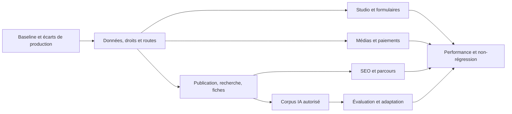

# Plan de travail technique à partir de la cartographie

Ce plan organise l’analyse et les validations. Il n’affirme pas que chaque risque ci-dessous est une panne présente. Ne transformer une action d’audit en correction qu’après lecture du chemin réel et reproduction du problème.

## Dépendances

## Lots prioritaires

| ID | Priorité | Travail et livrable | Références principales | Critère d’acceptation |
|---|---|---|---|---|
| T01 | P0 | Établir la version réellement installée, médias présents, moteurs DB, configuration et caches, sans exporter leurs secrets | Manifestes, SiteInventory, SchemaHealth, TransactionHealth | Écarts code/configuration/données/médias explicitement séparés ; sauvegarde restaurable |
| T02 | P0 | Vérifier les droits selon les acteurs et les ancêtres, le type/section du champ et les projections publiques | ProductAccess, NativeAccess, Repository, ExtendedFields | Aucun contenu privé accessible par page, fichier, métadonnées, sitemap, recherche ou IA ; l’administrateur ne change pas la définition du public |
| T03 | P0 | Reproduire les défauts de publication et de destination, sans perdre les brouillons | NexusQuickPublish, NexusParticipation, NativeAuthoring, ProductLifecycle, ComponentRuntime | Message court enregistré une fois ; texte conservé en erreur ; format/destination corrects ; champs obligatoires respectés |
| T04 | P0 | Valider les routes, la sélection d’index et le formulaire d’offre | ForumRoutes, NativeUrls, EmploymentRoutes, NexusBlogIndex, contrôleurs natifs | Chaque fiche a sa bonne URL ; canonique et rechargement montrent le même contenu ; aucune ouverture arbitraire du premier blog |
| T05 | P1 | Vérifier chaque filtre et ses combinaisons avec les champs natifs et leurs index | EmploymentFilters, QueryBuilder, js_res_fields, js_res_record_values | Sélectivité, types de comparaison, pagination et état vide corrects ; pas de fuite de champ privé |
| T06 | P1 | Auditer les layouts, régions, menus et mode édition | DesignApi, DesignLayouts, DesignPermissions, DesignInlineParts, DesignNavigation | Seul l’acteur autorisé voit/utilise les contrôles ; un déplacement/suppression n’efface pas les données ; preview et publié séparés |
| T07 | P1 | Valider le builder de formulaires et les répétitions | DesignForms, NativeBindings, NexusAuthorForms | Champs natifs non perdus, validators conservés, étapes utilisables, champs complexes gardant leurs contrôles et cohérence des valeurs |
| T08 | P1 | Vérifier uploads et lecture média à charge représentative | NativeUploadGate, NativeChunkStore, NativeMedia, NativeCinema, AllVideoField/Bridge | Reprise après coupure, refus des mauvais fichiers, budget disque, accès, chapitres, timestamps, modules et mobile |
| T09 | P1 | Tester les événements de paiement en sandbox, puis la restitution des droits | SubscriptionCheckout/Gateway/Entitlements, JoomSubscription | Montant/devise/bénéficiaire/signature vérifiés ; doublons sans effet double ; remboursements/expirations/factures cohérents |
| T10 | P1 | Mesurer SQL, TTFB et rendu par parcours, proposer des batchs/index motivés | Cartes SQL, Repository, NativeAccess, NexusForumIndex, DesignRenderer | Comparaison avant/après sur mêmes conditions ; aucune suppression de contrôles d’accès ni de fonctionnalités |
| T11 | P1 | Vérifier concordance SEO et qualité éditoriale des contenus effectivement publics | PublicMaterial, NativeSemantic, NexusPlatform, EditorialImages, NexusSitemap, JmapBridge | Page, image HTTP 200, auteur, dates, schéma, canonique et maillage concordants ; pas d’agrégat d’avis inventé |
| T12 | P2 | Vérifier ingestion, retrait des sources, budgets et reprises IA | OmegaMemory/Web/Extract/Runtime, NexusKnowledge | Les sources retirées ou privées ne sont plus servies ; aucune instruction collectée exécutée ; provenance et erreurs traçables |
| T13 | P2 | Construire une évaluation IA crédible et suivre les régressions | OmegaRanker, NeuralStore/Trainer, OmegaGeneration/Adaptation, worker Python | Jeu de référence versionné, scores par tâche, citations correctes et promotion conditionnelle mesurée ; rollback testé |
| T14 | P2 | Renforcer les parcours sans ajouter de friction inutile | WorkQueue, PersonalPaths, JourneyCatalogue, ContextQuestions, AppDock | Une action suivante compréhensible pour chaque rôle ; facultatif et obligatoire clairement distingués ; aucune métrique artificielle |

## Protocole pour une correction

1. Citer la fonction et la ligne responsables ; relever les appels et données concernés.
2. Reproduire avec des données de test identifiées, sans simuler des membres publics réels.
3. Définir le comportement attendu et les conditions d’accès, erreurs et reprise.
4. Faire le changement le plus petit compatible avec le cœur JoomCCK et les extensions existantes.
5. Vérifier champs et index, relations, URL, version/révision et effets secondaires.
6. Tester le rôle autorisé, le rôle refusé et le scénario concurrent/dupliqué approprié.
7. Mesurer le coût serveur et l’expérience desktop/mobile si le chemin les affecte.
8. Livrer migration et retour arrière quand nécessaires ; préserver les données et réglages utilisateur.

## Critères de mesure à préciser avant le chantier

Ne pas fixer de délais ou budgets de charge à partir du seul nombre de fichiers. Définir les volumes, profils d’hébergement, nombre d’acteurs, tailles de médias et scénarios de trafic. Les objectifs Core Web Vitals peuvent servir de cible, mais leur respect doit être mesuré sur le terrain et non déduit des seules requêtes SQL.

Pour l’IA : distinguer justesse, fidélité des citations, rappel documentaire, accès aux sources, latence, coût d’extraction, fiabilité des refus et qualité d’une éventuelle adaptation des poids. Une meilleure moyenne ne suffit pas si une tâche critique régresse.
